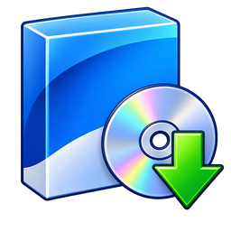

<div align="center">


<h1>OUTNO</h1>

<h3>Lightweight setup creator for Windows apps</h3>

<p><strong>Pick a folder. Build a setup. Ship it.</strong></p>

<p>OUTNO turns a folder with your application into a single <code>setup.exe</code> with a
familiar installation wizard, shortcuts, an Installed apps entry and an uninstaller.
No scripts, no admin rights, one small executable.</p>

<p>
  <a href="https://www.rust-lang.org/"></a>
  <a href="https://www.microsoft.com/windows"></a>
  <a href="#project-status"></a>
  <a href="LICENSE"></a>
</p>

<p>
  <strong>
    <a href="https://github.com/floringhitun223/outno/releases">Download latest release</a>
    · <a href="https://github.com/floringhitun223/outno/releases">All releases</a>
    · <a href="https://github.com/floringhitun223/outno/issues">Report a bug</a>
    · <a href="https://github.com/floringhitun223/outno/issues">Request a feature</a>
  </strong>
</p>

</div>

------------------------------------------------------------------------

## Contents

- [Why OUTNO](#why-outno)
- [Features](#features)
- [Quick start](#quick-start)
- [The OUTNO window](#the-outno-window)
- [Install modes and admin rights](#install-modes-and-admin-rights)
- [Languages](#languages)
- [Appearance](#appearance)
- [Code signing](#code-signing)
- [Project files (.outno)](#project-files-outno)
- [Command-line builds](#command-line-builds)
- [What the setup does on the user's PC](#what-the-setup-does-on-the-users-pc)
- [Troubleshooting](#troubleshooting)
- [How it works](#how-it-works)
- [Building OUTNO from source](#building-outno-from-source)
- [Project layout](#project-layout)
- [Roadmap](#roadmap)
- [Contributing](#contributing)
- [Security](#security)
- [License](#license)
## Why OUTNO

Tools like Inno Setup and NSIS are powerful, but they ask you to learn a
script language before you get your first installer. OUTNO is for the
common case: **you have a folder with an app in it and you want a clean
setup.exe for it.**

- **One file.** OUTNO is a single executable. The setups it creates are
  single executables too.
- **A form, not a script.** Fill in a few fields (most are detected for
  you) and click **Build setup**.
- **No admin rights by default.** Apps install per user. All-users installs
  into Program Files are one setting away, and the setup asks for admin
  rights only then.
## Project status

OUTNO is in early development. Everything listed under
[Features](#features) is implemented; items in the [Roadmap](#roadmap)
are planned, not available yet.

## Features

**Creating setups**

- **Single-file output:** the setup runtime, your app's files and the
  settings are packed into one `.exe`.
- **Smart detection:** choosing an app folder fills in the app name and
  install folder and picks the main executable. Helpers such as
  `unins*.exe`, crash handlers, redistributables and updaters are
  skipped.
- **Drag and drop:** drop an app folder, a `.outno` project, a license
  file or the main `.exe` onto the window.
- **Validation as you type:** missing or invalid fields are outlined in
  red with a short explanation.
- **Project files and command-line builds** for repeatable releases and CI.
- **Code signing:** run `signtool` (or any tool) on every build, for the
  setup and the uninstaller. See [Code signing](#code-signing).
- **Live build progress** with a per-file log, a **Show in folder**
  button and progress on the OUTNO taskbar button.

**The generated setup**

- **Familiar wizard:** Language → Welcome → License → Destination →
  Tasks → Ready → Installing → Finish.
- **Six built-in languages** (English, Română, Français, Deutsch, Español,
  Italiano), plus your own language packs. The setup pre-selects the
  Windows display language.
- **Per-user or all-users installs.** You can also let the user choose.
  Admin rights are requested only when needed. See
  [Install modes](#install-modes-and-admin-rights).
- **Upgrades:** an earlier install is detected and its folder reused. The
  uninstaller then also removes files the old version installed.
- **Clear errors and Retry:** errors name the file involved. A file that
  is in use asks you to close the app and click **Retry**.
- **Your branding:** wizard banner image, header image, accent colour,
  and the setup file's icon (OUTNO's, your app's, or any `.ico`).
- **License agreement** from a `.txt`, `.md` or `.rtf` file.
- **Desktop and Start Menu shortcuts**, chosen by the user.
- **Installed apps entry** with version, publisher, website, icon and size.
- **Clean uninstaller:** it runs from a temporary copy, so the whole
  install folder is removed (including `unins000.exe`), in the language
  chosen during setup.
- **Taskbar progress:** green while copying, red on error. The button
  flashes when setup finishes in the background.
- **Protected close:** the window can't be closed while files are being
  copied.
- **Archive path protection:** entries that try to escape the install
  folder (`../`) are ignored.
## Quick start

1. Download `outno.exe` from the
   [releases page](https://github.com/floringhitun223/outno/releases)
   and run it.
2. Drag your app's folder onto the window, or click **Browse...** next to
   **Application folder**.
3. Check the detected **Application name** and **Main executable**, then
   set the **Version** and, optionally, the publisher and website.
4. Click **Build setup** or press **F9**.
5. Click **Show in folder** to find `<App>-setup-<version>.exe`.

## The OUTNO window

| Section         | Fields                                                                                           |
|-----------------|--------------------------------------------------------------------------------------------------|
| **Application** | Name *(required)*, version *(required)*, publisher, website                                      |
| **Files**       | Application folder *(required)*, main executable *(required)*, license file (`.txt` / `.rtf` / `.md`) |
| **Installer**   | Install folder name, install for (current user / all users / let the user choose), shortcuts, launch at finish |
| **Languages**   | Built-in languages, custom language files, template export                                       |
| **Appearance**  | Wizard image, header image, accent colour, setup icon                                            |
| **Output**      | Output folder *(required)*, setup file name, sign command                                        |

Once an app folder is chosen, OUTNO shows how many files it contains,
their total size and how many executables it found. **Detected...** next to
**Main executable** lists the `.exe` files found in the app folder and the
first two levels of subfolders.

### Keyboard shortcuts

| Shortcut           | Action               |
|--------------------|----------------------|
| `F9` or `Ctrl+B`   | Build setup          |
| `Ctrl+S`           | Save project         |
| `Ctrl+Shift+S`     | Save project as...   |
| `Ctrl+O`           | Open project         |
| `Ctrl+N`           | New project          |

## Install modes and admin rights

| Install for                        | Default folder                   | Registry | Shortcuts            | Admin rights        |
|------------------------------------|----------------------------------|----------|----------------------|---------------------|
| **Current user** *(default)*       | `%LOCALAPPDATA%\Programs\<App>`  | `HKCU`   | the user's           | no                  |
| **All users**                      | `%ProgramFiles%\<App>`           | `HKLM`   | Public / ProgramData | yes (UAC prompt)    |
| **Let the user choose**            | either, picked on the Destination page | | | only for all users |

OUTNO itself and its setups run without admin rights (`asInvoker`).
When admin rights are needed, the wizard starts an elevated copy of
itself for the copying only. The UAC prompt appears when you click
**Install**, and the wizard keeps showing the progress. This covers
all-users installs and **any folder the user can't write to**, even in
per-user mode (for example `C:\Program Files\...` chosen with Browse).
The app is still launched as the normal user at the end.

The uninstaller asks for admin rights only for all-users installs.

## Languages

- Tick the built-in languages in the **Languages** card. With more than
  one, the setup starts with a language picker that pre-selects the
  Windows display language.
- **Your own language:** click **Export template...** to save the English
  strings as JSON, translate them, and add the file with **Add language
  file...**. A custom pack with the same `code` as a built-in one
  replaces it. Missing keys fall back to English, so partial
  translations work.
- The uninstaller uses the language chosen during setup.

```json
{
  "code": "pt",
  "name": "Português",
  "strings": {
    "btn_next": "Avançar >",
    "welcome_title": "Bem-vindo ao assistente de instalação do {app}",
    "...": "..."
  }
}
```

Placeholders such as `{app}`, `{version}`, `{path}` and `{size}` are
filled in by the setup.

## Appearance

| Option            | Notes                                                                                     |
|-------------------|-------------------------------------------------------------------------------------------|
| **Wizard image**  | PNG for the side banner of the Welcome / Finish pages, about 164 × 314. It is scaled to fill the banner and cropped evenly at the edges. |
| **Header image**  | Small PNG for the top-right of the other pages, about 48 × 48 (wider logos fit up to 120 × 48). |
| **Accent colour** | Buttons, links, progress bar and the banner gradient.                                      |
| **Setup icon**    | **OUTNO**, **App's icon** (taken from the main executable) or **Custom .ico**. The uninstaller gets the same icon. Needs Windows; elsewhere the build logs a warning and keeps the OUTNO icon. |

## Code signing

Set **Sign command** in the Output card (or `sign_command` in the
project). `$f` is replaced by the quoted path of the file to sign:

```text
signtool sign /fd sha256 /tr http://timestamp.digicert.com /td sha256 /a $f
```

On every build OUTNO:

1. Signs a copy of the uninstaller, which the setup installs as
   `unins000.exe`.
2. Builds the setup.
3. Signs the setup and checks that the signed file still opens as a
   setup.

Signed setups and uninstallers work normally. OUTNO finds its data in
front of the signature, and strips any existing signature before
building, so OUTNO itself can be signed too.

> **Note:** the sign command is saved in the project file. Don't put
> certificate passwords in it. Use a certificate from the Windows
> certificate store (`/a`, `/n "Name"` or `/sha1 <thumbprint>`) or a
> hardware token instead.

Unsigned setups work too, but Windows SmartScreen may warn about them.
## Project files (.outno)

A project is a small JSON file holding every field in the window:

```json
{
  "app_name": "Atelier",
  "version": "1.4.0",
  "publisher": "FlorinDev",
  "url": "https://florindev.ro",
  "source_dir": "dist\\Atelier",
  "main_exe": "Atelier.exe",
  "license_file": "LICENSE.rtf",
  "install_folder": "",
  "out_dir": "Output",
  "out_name": "",
  "desktop": true,
  "start_menu": true,
  "launch": true,
  "install_mode": "Ask",
  "languages": ["en", "ro"],
  "custom_languages": [],
  "wizard_image": "branding\\wizard.png",
  "header_image": "",
  "accent": [22, 140, 80],
  "setup_icon": "App",
  "icon_file": "",
  "sign_command": "signtool sign /fd sha256 /tr http://timestamp.digicert.com /td sha256 /a $f"
}
```

- `install_mode` is `"PerUser"`, `"AllUsers"` or `"Ask"`.
- `setup_icon` is `"Outno"`, `"App"` or `"Custom"` (with `icon_file`).
- **Relative paths** are resolved against the folder containing the
  `.outno` file, so a project can be committed next to your source code.
- **Missing fields** fall back to their defaults, so older projects still
  open.
- **Opening a project:** pass it as the first argument
  (`outno.exe MyApp.outno`), drop it on the window or use **Open...**.
## Command-line builds

Build a setup without opening the window:

```powershell
outno.exe --build MyApp.outno
```

| Exit code | Meaning                                              |
|-----------|------------------------------------------------------|
| `0`       | Setup built; its path is printed                     |
| `1`       | Validation or build error; details are printed       |
| `2`       | No project file given                                |

OUTNO is a windowed program, so in `cmd.exe` the prompt may come back
before its output. To wait for it to finish, run
`start /wait outno.exe --build MyApp.outno`, or call it from PowerShell
with `Start-Process -Wait`.

## What the setup does on the user's PC

| Step            | Result                                                                                        |
|-----------------|-----------------------------------------------------------------------------------------------|
| Files           | Extracted to the destination folder. Existing read-only files are made writable first          |
| Shortcuts       | `<App>.lnk` on the Desktop and in `Start Menu\Programs\<App>\`, if ticked                     |
| Uninstaller     | `unins000.exe` + `unins000.dat` (a JSON list of everything installed) in the install folder   |
| Registry        | `Software\Microsoft\Windows\CurrentVersion\Uninstall\<App>` in `HKCU` or `HKLM`             |
| Upgrades        | The earlier install folder is reused, and the old file list is merged into the new one        |
| Finish page     | Optionally launches the main executable as the normal user                                    |

The uninstaller first copies itself to `%TEMP%` and runs from there, so
it can delete the whole install folder. Files the app created later, such
as settings or logs, stay in place, and the folder is removed only if it
ends up empty.

## Troubleshooting

**"Access to ... was denied"**: the setup can't write to that folder.
Setups now detect folders that need admin rights and show a UAC prompt
on their own. If you still see this, the folder may be protected by
security software. Choose another folder, or use **All users** mode.

**"... is in use. Close <App> and click Retry."**: the app, or a file
it uses, is still running. Close it, then click **Retry**; the setup
continues where it failed.

**"Administrator permission was not granted"**: the UAC prompt was
declined. Click **Retry** to see it again, or go back and choose a folder
you can write to.

Errors always name the file or folder involved.
## How it works

One executable plays several roles, decided at startup:

| Role                 | When                                                  | What it does                                 |
|----------------------|-------------------------------------------------------|----------------------------------------------|
| **Compiler**         | Nothing is appended to the exe                        | The OUTNO window (or `--build`)              |
| **Installer**        | A payload is appended to the exe                      | The setup wizard                             |
| **Install helper**   | Setup started with `--elevated-install <job>`         | Elevated, windowless copying; reports progress to the wizard |
| **Uninstaller**      | `unins000.exe --uninstall "<dir>"`                    | Relaunches from `%TEMP%`, then shows the uninstall window |
| **Uninstall helper** | `--uninstall "<dir>" --elevated-job`                  | Elevated, windowless removal (all-users installs) |

To build a setup, OUTNO copies its own executable (the *stub*), with any
code signature removed, and appends your files and settings to it:

```text
[OUTNO stub executable]            optionally with your icon
[application ZIP archive]          your app + "$outno/" setup resources
[manifest.json]                    name, version, options, languages, license text
[ZIP length         u64 LE]
[manifest length    u64 LE]
["RSINST01"]                       8-byte magic
[padding + Authenticode signature] only if the setup is signed
```

At startup the executable reads the PE header to find where any signature
starts, then looks for the magic just before it. It reads the manifest
and opens the ZIP in place, streaming it from the file. Archive entries
under `$outno/` (wizard images, signed uninstaller) are setup resources
and are never extracted into the install folder.
## Building OUTNO from source

### Requirements

- Windows 10 or 11
- [Rust](https://www.rust-lang.org/tools/install) (stable)
- [Visual Studio Build Tools](https://visualstudio.microsoft.com/visual-cpp-build-tools/)
  with **Desktop development with C++**, including a **Windows SDK**.
  The SDK's `rc.exe` embeds the icon and manifest.

### Build

```powershell
rustup target add x86_64-pc-windows-msvc   # if not installed yet
cargo build --release
```

The result is `target\release\outno.exe`. The release profile optimises
for size (`opt-level = "z"`, LTO, stripped, `panic = "abort"`), because
every setup OUTNO creates starts with a copy of this file.

> **Note:** build in release mode before distributing setups. A debug
> build works but makes every setup much larger.

### Icon and branding

| File                   | Used for                                                     |
|------------------------|--------------------------------------------------------------|
| `assets/outno.ico`     | Embedded exe icon (16–256 px), via `build.rs` + `winresource` |
| `assets/outno-256.png` | Window icon and in-app artwork (compiled in)                 |
| `assets/outno-icon.png`| Full-resolution artwork for this README and releases         |
| `assets/outno.manifest`| Windows manifest: `asInvoker`, per-monitor DPI v2, long paths, modern controls |

To change the icon, replace those image files and rebuild.

On Windows, OUTNO uses the system **Segoe UI** font when it is
available. Otherwise it falls back to egui's built-in fonts.

### Other platforms

The code compiles on Linux and macOS (`cargo check`), where the
Windows-specific parts (shortcuts, registry, resources) are stubbed out.
This is meant for development only: the setups OUTNO creates target
Windows.

## Project layout

```text
outno/
├── assets/
│   ├── outno.ico           exe icon (multi-size)
│   ├── outno-256.png       embedded window icon / artwork
│   ├── outno-icon.png      full-size artwork
│   └── outno.manifest      Windows application manifest
├── src/
│   ├── main.rs             role selection: compiler / installer / helpers / uninstaller
│   ├── builder.rs          OUTNO window, validation, projects, packing, signing
│   ├── installer.rs        setup wizard, install / elevation / upgrade, uninstaller
│   ├── lang.rs             language packs (en, ro, fr, de, es, it) and lookup
│   ├── payload.rs          payload format, signature-aware reader, stub writer
│   ├── platform.rs         paths, shortcuts, registry, permissions, self-delete
│   ├── rtf.rs              RTF → text for license files
│   ├── taskbar.rs          progress on the Windows taskbar button (ITaskbarList3)
│   ├── win.rs              UAC elevation, UI language, exe icon replacement (Win32)
│   └── ui.rs               theme, fonts, header / footer / banner / dialogs
├── build.rs                embeds icon, version info and manifest on Windows
└── Cargo.toml
```

`cargo test` checks the language packs (every key in every language),
the RTF converter and the `.ico` parser.
## Roadmap

Done:

- [x] Application icon and Windows manifest in OUTNO, setups and uninstallers
- [x] Save and load projects (`.outno`), command-line builds
- [x] Drag and drop, validation and main-exe detection
- [x] Install and build progress on the Windows taskbar button
- [x] All-users installation into `Program Files` with elevation
- [x] The app's own icon (or any `.ico`) for the generated setup
- [x] Installer language packs (6 built in + custom JSON packs)
- [x] Custom wizard images and accent colour
- [x] Rich-text (`.rtf`) license files
- [x] Upgrade detection (reuse the previous install folder)
- [x] Code-signing workflow for setups and uninstallers

Ideas for later:

- [ ] Silent installs (`/silent`, `/dir=...`) for IT deployment
- [ ] Optional components (choose which parts to install)
- [ ] File associations and custom shortcuts
- [ ] Prerequisite checks (e.g. .NET or VC++ runtime)

The roadmap may change as development progresses.
## Contributing

Contributions, bug reports and feature suggestions are welcome.

Before opening a pull request:

1. Check existing issues to avoid duplicates.
2. Describe the problem or proposed change clearly.
3. Include reproduction steps for bug fixes where possible.
4. Keep changes focused and document user-facing behaviour.
5. Run `cargo clippy` and make sure it is warning-free.

Use the [Issues](https://github.com/floringhitun223/outno/issues) page
to report bugs or suggest features.

## Security

Installer software handles executables, archives and filesystem
operations. If you find a potential security vulnerability, please
contact the maintainer privately rather than publishing exploit details
in a public issue.

Only package software you own or have permission to distribute. Test
generated setups in a safe environment before distributing them, and
[sign them](#code-signing) so Windows SmartScreen can trust them.

## License

OUTNO is licensed under the [MIT License](LICENSE).

------------------------------------------------------------------------

<div align="center">

<br>
<strong>OUTNO</strong> · Lightweight setup creator

</div>
