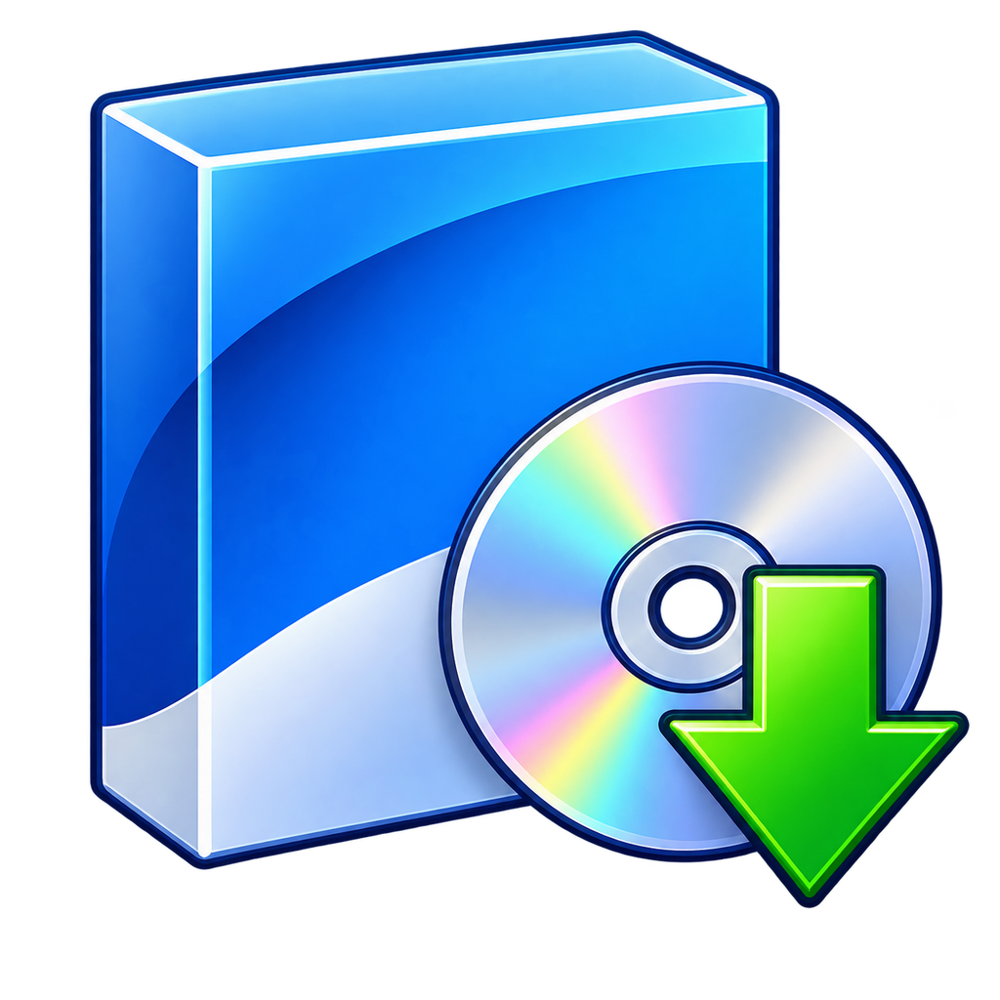

<div align="center">



<h1>OUTNO</h1>

<h3>Lightweight setup creator for Windows apps</h3>

<p><strong>Pick a folder. Build a setup. Ship it.</strong></p>

<p>OUTNO turns a folder with your application into a single <code>setup.exe</code> with a
familiar installation wizard, shortcuts, an Installed apps entry and an uninstaller.
No scripts, no admin rights, one small executable.</p>

<p>
  <a href="https://www.rust-lang.org/"></a>
  <a href="https://www.microsoft.com/windows"></a>
  <a href="#project-status"></a>
  <a href="LICENSE"></a>
</p>

<p>
  <strong>
    <a href="https://github.com/floringhitun223/outno/releases">Download latest release</a>
    · <a href="https://github.com/floringhitun223/outno/releases">All releases</a>
    · <a href="https://github.com/floringhitun223/outno/issues">Report a bug</a>
    · <a href="https://github.com/floringhitun223/outno/issues">Request a feature</a>
  </strong>
</p>

</div>

------------------------------------------------------------------------

## Contents

- [Why OUTNO](#why-outno)
- [Features](#features)
- [Quick start](#quick-start)
- [The OUTNO window](#the-outno-window)
- [Project files (.outno)](#project-files-outno)
- [Command-line builds](#command-line-builds)
- [What the setup does on the user's PC](#what-the-setup-does-on-the-users-pc)
- [How it works](#how-it-works)
- [Building OUTNO from source](#building-outno-from-source)
- [Project layout](#project-layout)
- [Roadmap](#roadmap)
- [Contributing](#contributing)
- [Security](#security)
- [License](#license)

## Why OUTNO

Tools like Inno Setup and NSIS are powerful, but they ask you to learn a
script language before you get your first installer. OUTNO is for the
common case: **you have a folder with an app in it and you want a clean
setup.exe for it.**

- **One file.** OUTNO is a single executable. The setups it creates are
  single executables too.
- **A form, not a script.** Fill in a few fields (most are detected for
  you) and click **Build setup**.
- **No admin rights.** Apps install per user, so neither you nor your
  users ever see a UAC prompt.

## Project status

OUTNO is in early development. Everything listed under
[Features](#features) is implemented; items in the [Roadmap](#roadmap)
are planned, not available yet.

## Features

**Creating setups**

- **Single-file output:** the setup runtime, your app's files and the
  settings are packed into one `.exe`.
- **Smart detection:** choosing an app folder fills in the app name and
  install folder and picks the main executable. Helpers such as
  `unins*.exe`, crash handlers, redistributables and updaters are
  skipped.
- **Drag and drop:** drop an app folder, a `.outno` project, a license
  `.txt` or the main `.exe` onto the window.
- **Validation as you type:** missing or invalid fields are outlined
  in red with a short explanation, and OUTNO won't build until they are
  fixed.
- **Project files:** save every setting to a `.outno` file and open it
  again later, or pass it to `--build` for scripted builds.
- **Command-line builds** for CI or release scripts.
- **Live build progress** with a per-file log and a **Show in folder**
  button when the build finishes. Progress also shows on the OUTNO
  taskbar button, and the button flashes when a build finishes in the
  background.
- **Safe packing:** if the output folder sits inside the app folder,
  it is skipped so a setup never packs itself.

**The generated setup**

- **Familiar wizard:** Welcome → License → Destination → Tasks → Ready
  → Installing → Finish, with Back / Next / Cancel, **Enter** for Next
  and **Esc** for Cancel.
- **OUTNO branding:** the OUTNO icon on the setup and uninstaller
  executables, their windows, the wizard header and the side banner.
- **Taskbar progress:** the setup's taskbar button fills green as files
  are copied, turns red if setup fails, and flashes when installation
  ends while the window is in the background.
- **Per-user installation** into `%LOCALAPPDATA%\Programs\<App>`, with
  no admin rights needed.
- **Desktop and Start Menu shortcuts**, chosen by the user on the
  Tasks page.
- **Installed apps entry** (Add/Remove Programs) under `HKCU`, with
  version, publisher, website and icon.
- **Uninstaller** (`unins000.exe`) that removes exactly the files,
  folders, shortcuts and registry key the setup created.
- **Protected close:** closing the window asks for confirmation, and
  the window can't be closed while files are being copied.
- **Archive path protection:** entries that try to escape the install
  folder (`../`) are ignored.

## Quick start

1. Download `outno.exe` from the
   [releases page](https://github.com/floringhitun223/outno/releases)
   and run it.
2. Drag your app's folder onto the window, or click **Browse...** next to
   **Application folder**.
3. Check the detected **Application name** and **Main executable**, then
   set the **Version** and, optionally, the publisher and website.
4. Click **Build setup** or press **F9**.
5. Click **Show in folder** to find `<App>-setup-<version>.exe`.

## The OUTNO window

The window is split into four sections.

| Section         | Fields                                                                                           |
|-----------------|--------------------------------------------------------------------------------------------------|
| **Application** | Name *(required)*, version *(required)*, publisher, website                                      |
| **Files**       | Application folder *(required)*, main executable *(required)*, license file (`.txt` / `.md`)     |
| **Installer**   | Install folder name, desktop / Start Menu shortcuts ticked by default, offer to launch at finish |
| **Output**      | Output folder *(required)*, setup file name (defaults to `<App>-setup-<version>.exe`)            |

Once an app folder is chosen, OUTNO shows how many files it contains,
their total size and how many executables it found. **Detected...** next to
**Main executable** lists the `.exe` files found in the app folder and the
first two levels of subfolders.

### Keyboard shortcuts

| Shortcut           | Action               |
|--------------------|----------------------|
| `F9` or `Ctrl+B`   | Build setup          |
| `Ctrl+S`           | Save project         |
| `Ctrl+Shift+S`     | Save project as...   |
| `Ctrl+O`           | Open project         |
| `Ctrl+N`           | New project          |

## Project files (.outno)

A project is a small JSON file holding every field in the window:

```json
{
  "app_name": "NotePad Plus",
  "version": "2.4.1",
  "publisher": "FlorinDev",
  "url": "https://florindev.ro",
  "source_dir": "dist\\NotePad Plus",
  "main_exe": "NotePad Plus.exe",
  "license_file": "LICENSE.txt",
  "install_folder": "",
  "out_dir": "Output",
  "out_name": "",
  "desktop": true,
  "start_menu": true,
  "launch": true
}
```

- **Relative paths** in `source_dir`, `license_file` and `out_dir` are
  resolved against the folder containing the `.outno` file, so a project
  can be committed next to your source code.
- **Missing fields** fall back to their defaults.
- **Opening a project:** pass it as the first argument
  (`outno.exe MyApp.outno`), drop it on the window or use **Open...**.
- **Unsaved changes** are marked with `•` next to the project name and
  `*` in the title bar.

## Command-line builds

Build a setup without opening the window:

```powershell
outno.exe --build MyApp.outno
```

| Exit code | Meaning                                              |
|-----------|------------------------------------------------------|
| `0`       | Setup built; its path is printed                     |
| `1`       | Validation or build error; details are printed       |
| `2`       | No project file given                                |

OUTNO is a windowed program, so in `cmd.exe` the prompt may come back
before its output. To wait for it to finish, run
`start /wait outno.exe --build MyApp.outno`, or call it from PowerShell
with `Start-Process -Wait`.

## What the setup does on the user's PC

| Step            | Result                                                                                        |
|-----------------|-----------------------------------------------------------------------------------------------|
| Files           | Extracted to `%LOCALAPPDATA%\Programs\<install folder>` (the user can choose another folder)  |
| Shortcuts       | `<App>.lnk` on the Desktop and in `Start Menu\Programs\<App>\`, if ticked                     |
| Uninstaller     | `unins000.exe` + `unins000.dat` (a JSON list of everything installed) in the install folder   |
| Registry        | `HKCU\Software\Microsoft\Windows\CurrentVersion\Uninstall\<App>`                              |
| Finish page     | Optionally launches the main executable                                                       |

The uninstaller removes only what the setup recorded. Files the app
created later, such as settings or logs, stay in place, and the install
folder is removed only if it ends up empty.

Setups request `asInvoker` in their application manifest. This also stops
Windows' *installer detection* from forcing a UAC prompt just because a
file is named `*setup*.exe`.

## How it works

One executable plays three roles, decided at startup:

| Role            | When                                             | What it shows                     |
|-----------------|--------------------------------------------------|-----------------------------------|
| **Compiler**    | Nothing is appended to the exe                   | The OUTNO window (or `--build`)   |
| **Installer**   | A payload is appended to the exe                 | The setup wizard                  |
| **Uninstaller** | Started as `unins000.exe --uninstall "<dir>"`    | The uninstall confirmation        |

To build a setup, OUTNO copies its own executable (the *stub*) and
appends your files and settings to it:

```text
[OUTNO stub executable]
[application ZIP archive]          deflate-compressed app folder
[manifest.json]                    app name, version, options, license text
[ZIP length         u64 LE]
[manifest length    u64 LE]
["RSINST01"]                       8-byte magic
```

At startup the executable reads the last 24 bytes. If they end with the
magic, it reads the manifest and opens the ZIP in place, streaming it from
the file rather than loading it into memory, and starts the wizard. The
uninstaller is the stub alone, without the payload, so it carries the
same icon and UI.

## Building OUTNO from source

### Requirements

- Windows 10 or 11
- [Rust](https://www.rust-lang.org/tools/install) (stable)
- [Visual Studio Build Tools](https://visualstudio.microsoft.com/visual-cpp-build-tools/)
  with **Desktop development with C++**, including a **Windows SDK**.
  The SDK's `rc.exe` embeds the icon and manifest.

### Build

```powershell
rustup target add x86_64-pc-windows-msvc   # if not installed yet
cargo build --release
```

The result is `target\release\outno.exe`. The release profile optimises
for size (`opt-level = "z"`, LTO, stripped, `panic = "abort"`), because
every setup OUTNO creates starts with a copy of this file.

> **Note:** build in release mode before distributing setups. A debug
> build works but makes every setup much larger.

### Icon and branding

| File                   | Used for                                                     |
|------------------------|--------------------------------------------------------------|
| `assets/outno.ico`     | Embedded exe icon (16–256 px), via `build.rs` + `winresource` |
| `assets/outno-256.png` | Window icon and in-app artwork (compiled in)                 |
| `assets/outno-icon.png`| Full-resolution artwork for this README and releases         |
| `assets/outno.manifest`| Windows manifest: `asInvoker`, per-monitor DPI v2, long paths, modern controls |

To change the icon, replace those image files and rebuild.

On Windows, OUTNO uses the system **Segoe UI** font when it is
available. Otherwise it falls back to egui's built-in fonts.

### Other platforms

The code compiles on Linux and macOS (`cargo check`), where the
Windows-specific parts (shortcuts, registry, resources) are stubbed out.
This is meant for development only: the setups OUTNO creates target
Windows.

## Project layout

```text
outno/
├── assets/
│   ├── outno.ico           exe icon (multi-size)
│   ├── outno-256.png       embedded window icon / artwork
│   ├── outno-icon.png      full-size artwork
│   └── outno.manifest      Windows application manifest
├── src/
│   ├── main.rs             role selection: compiler / installer / uninstaller / --build
│   ├── builder.rs          OUTNO window, validation, projects, packing
│   ├── installer.rs        setup wizard, extraction, uninstaller
│   ├── payload.rs          appended-payload format and streaming ZIP reader
│   ├── platform.rs         shortcuts, registry, Explorer, self-delete
│   ├── taskbar.rs          progress on the Windows taskbar button (ITaskbarList3)
│   └── ui.rs               theme, fonts, header / footer / banner / dialogs
├── build.rs                embeds icon, version info and manifest on Windows
└── Cargo.toml
```

## Roadmap

Done in 0.2:

- [x] Application icon and Windows manifest embedded in OUTNO, setups and uninstallers
- [x] Save and load projects (`.outno`)
- [x] Command-line builds (`--build`)
- [x] Drag and drop, validation and main-exe detection in the OUTNO window
- [x] Install and build progress on the Windows taskbar button

Next:

- [ ] All-users installation into `Program Files` (with elevation)
- [ ] Use the app's own icon for the generated setup exe
- [ ] Installer language packs
- [ ] Custom wizard images and colours
- [ ] Rich-text (`.rtf`) license files
- [ ] Upgrade detection (reuse the previous install folder)
- [ ] Code-signing workflow for generated setups

The roadmap may change as development progresses.

## Contributing

Contributions, bug reports and feature suggestions are welcome.

Before opening a pull request:

1. Check existing issues to avoid duplicates.
2. Describe the problem or proposed change clearly.
3. Include reproduction steps for bug fixes where possible.
4. Keep changes focused and document user-facing behaviour.
5. Run `cargo clippy` and make sure it is warning-free.

Use the [Issues](https://github.com/floringhitun223/outno/issues) page
to report bugs or suggest features.

## Security

Installer software handles executables, archives and filesystem
operations. If you find a potential security vulnerability, please
contact the maintainer privately rather than publishing exploit details
in a public issue.

Only package software you own or have permission to distribute. Test
generated setups in a safe environment before distributing them. Setups
are not code-signed by OUTNO, so Windows SmartScreen may warn about
them until you sign them yourself.

## License

OUTNO is licensed under the [MIT License](LICENSE).

------------------------------------------------------------------------

<div align="center">

<br>
<strong>OUTNO</strong> · Lightweight setup creator

</div>
